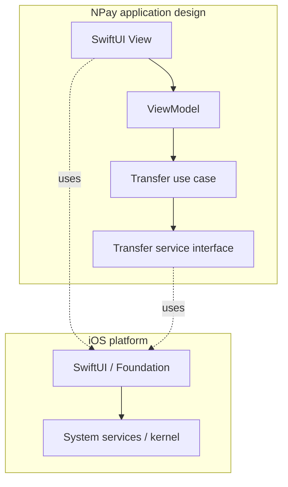
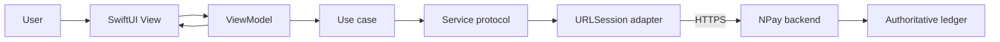
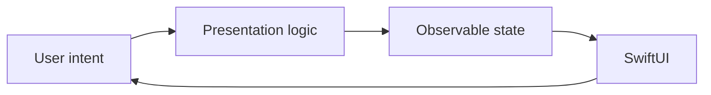
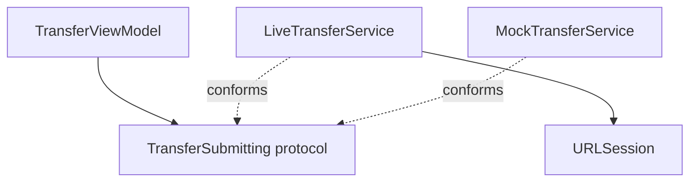
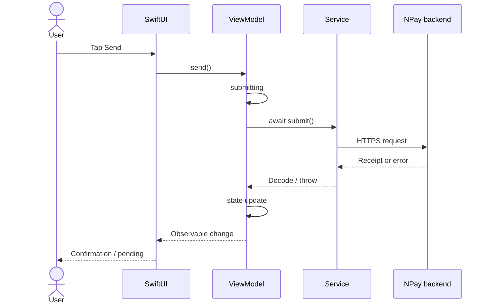

# Unit 0 · Lesson 0.2 — iOS Application Architecture

**Project:** NPay · **Audience:** experienced programmers new to iOS · **Format:** complete reconstructed teaching guide for Codex, not verbatim chat export.

## Learning outcomes

Explain platform vs application architecture; trace a payment from SwiftUI to the backend; compare MVC, MVVM and layered architecture; separate view, state, domain, service and persistence responsibilities; introduce dependency injection, security boundaries and tests.

**Continuous story:** NPay has launched (Lesson 0.1). The user sees a balance and taps **Send ₹500**. Who owns the validation, loading indicator, network call, error message and final confirmation?

## Chapter 1 — Why architecture matters

### Scene 1 — Start with the NPay screen

Show a large iPhone dashboard with balance, activity and **Send Money**. Ask: “We know how the OS launched the app. What happens in *our code* after Send is tapped?” Do not reveal the answer immediately.

### Scene 2 — The tempting giant view

```swift
import SwiftUI
struct SendMoneyView: View {
    @State private var amountText = "500"
    @State private var status = ""
    var body: some View {
        VStack {
            TextField("Amount", text: $amountText)
            Button("Send") {
                // Temptation: validation, API, storage,
                // navigation and error handling all here.
                status = "Starting..."
            }
            Text(status)
        }
    }
}
```

**Ask:** How do we test transfer validation without launching a view? How do we reuse the logic? Why might this grow into a Massive View?

### Scene 3 — The real purpose of architecture

Architecture provides boundaries for change, testability, ownership and reasoning. More classes and folders do not automatically mean better design. **Analogy:** dining room = UI; order coordinator = presentation; kitchen = domain rules; suppliers = data adapters.

## Chapter 2 — Two different architectures

### Scene 4 — Platform versus application architecture



**Platform:** process, threads, virtual memory, sandbox, display. **Application:** validation, state, business operations, networking and data management. The bank backend is a separate system, not part of the app process.

### Scene 5 — End-to-end NPay architecture



**Key principle:** Client checks improve usability. Server-side authentication, authorization, fraud policy, idempotency and ledger consistency remain authoritative.

## Chapter 3 — SwiftUI and state

### Scene 6 — View as description

```swift
struct BalanceCard: View {
    let formattedBalance: String
    var body: some View {
        VStack(alignment: .leading) {
            Text("Available balance")
            Text(formattedBalance).font(.title)
        }
    }
}
```

SwiftUI views describe desired UI. Constructing a view value does not directly draw pixels.

### Scene 7 — Explicit screen states

```swift
enum TransferScreenState: Equatable {
    case idle
    case submitting
    case success(reference: String)
    case failure(message: String)
    case pending(reference: String?)
}
```

One state enum prevents contradictory booleans (`isLoading`, `hasError`, `isSuccessful`). The `pending` state matters because a payment request can time out even if the backend completed it.

### Scene 8 — State flow



**Ask:** Who decides that a spinner appears? ViewModel/state. Who renders it? SwiftUI.

## Chapter 4 — ViewModel, domain and service

### Scene 9 — ViewModel responsibilities

**Own:** screen state, loading, presentation formatting, async coordination. **Avoid:** backend authorization rules, direct database implementation, unrelated features and unprotected credential storage.

### Scene 10 — ViewModel implementation

```swift
import Observation

protocol TransferSubmitting: Sendable {
    func submit(destination: String, amountInPaise: Int64) async throws -> String
}

@MainActor
@Observable
final class TransferViewModel {
    private(set) var state: TransferScreenState = .idle
    var amountInPaiseText = "50000"
    private let service: any TransferSubmitting

    init(service: any TransferSubmitting) {
        self.service = service
    }

    func send(to destination: String) async {
        guard let amount = Int64(amountInPaiseText), amount > 0 else {
            state = .failure(message: "Invalid amount")
            return
        }
        state = .submitting
        do {
            let ref = try await service.submit(
                destination: destination, amountInPaise: amount
            )
            state = .success(reference: ref)
        } catch is CancellationError {
            state = .pending(reference: nil)
        } catch {
            state = .pending(reference: nil)
        }
    }
}
```

**Caveat:** This is a pedagogical skeleton for iOS 17+ Observation. It takes input in *paise* deliberately. Production UI needs deliberate rupee parsing and rounding. A cancellation or timeout after submission does not prove the payment failed; reconcile with the backend.

### Scene 11 — Domain values

```swift
struct Money: Equatable, Sendable { let paise: Int64 }
struct TransferRequest: Sendable {
    let destinationAccountId: String
    let amount: Money
}
struct TransferReceipt: Sendable { let reference: String }
```

Use values for amounts and requests. Business use cases coordinate an operation but do not replace authoritative server validation.

### Scene 12 — Dependency inversion



High-level code depends on an abstraction. Test code can inject a mock without a real network.

### Scene 13 — Mock implementation

```swift
struct MockTransferService: TransferSubmitting {
    func submit(destination: String, amountInPaise: Int64) async throws -> String {
        "NPAY-DEMO-001"
    }
}
```

## Chapter 5 — Networking and execution flow

### Scene 14 — Live transport sketch

```swift
import Foundation
struct LiveTransferService: TransferSubmitting {
    let session: URLSession
    let endpoint: URL

    func submit(destination: String, amountInPaise: Int64) async throws -> String {
        struct Payload: Encodable {
            let destination: String
            let amountInPaise: Int64
        }
        struct Reply: Decodable { let reference: String }
        var request = URLRequest(url: endpoint)
        request.httpMethod = "POST"
        request.setValue("application/json", forHTTPHeaderField: "Content-Type")
        request.httpBody = try JSONEncoder().encode(
            Payload(destination: destination, amountInPaise: amountInPaise)
        )
        // Demo only: real code needs secure auth, idempotency,
        // status reconciliation, error classification and safe logging.
        let (data, response) = try await session.data(for: request)
        guard let http = response as? HTTPURLResponse,
              (200...299).contains(http.statusCode) else {
            throw URLError(.badServerResponse)
        }
        return try JSONDecoder().decode(Reply.self, from: data).reference
    }
}
```

Do not send real payments using this skeleton. The endpoint is an injected test endpoint.

### Scene 15 — Animated sequence



**Trainer challenge:** If the request times out, can the UI safely display “Payment failed”? **No.** The result may be unknown. Use backend reconciliation and idempotency keys.

## Chapter 6 — Storage, security, lifecycle and concurrency

### Scene 16 — Choose storage by data type

| Data | Owner | Caution |
|---|---|---|
| Loading state | ViewModel | Ephemeral |
| Theme | UserDefaults | Nonsecret |
| Auth token | Keychain | Access controls |
| Cached activity | SwiftData/files | Freshness and data protection |
| Balance | Backend | Client copy not authoritative |

### Scene 17 — Security crosses layers

Signing, sandbox, Keychain, HTTPS and backend authorization protect different boundaries. No single class or permission secures everything.

### Scene 18 — Concurrency

Use `@MainActor` for UI-related mutable state. `await` suspends a task rather than automatically blocking a thread. Actor isolation protects mutable state, but actors can be reentrant across `await`, so do not assume actor methods provide durable transactions.

### Scene 19 — Lifecycle

If a user leaves NPay during submission, the view's task may be cancelled. Cancellation of local work does **not** prove a backend payment was cancelled. Preserve a recoverable transaction reference/idempotency identifier and reconcile status appropriately.

## Chapter 7 — Architecture alternatives

### Scene 20 — MVC

Common in UIKit. Model–View–Controller can work well, but a controller that owns every concern becomes difficult to maintain.

### Scene 21 — MVVM

Common with SwiftUI, not mandated by Apple. View describes UI; ViewModel coordinates presentation state; model/domain expresses values and operations.

### Scene 22 — Unidirectional data flow

Action → state transition → render. Particularly helpful for complex multi-step payment flows and testable state transitions.

### Scene 23 — Layered/Clean architecture

Domain policy can be separated from transport and persistence adapters. Useful when complexity warrants it; don't create meaningless layers just for appearances.

### Scene 24 — Suggested NPay structure

```text
NPay/
  App/
  Features/
    Dashboard/
      DashboardView.swift
      DashboardViewModel.swift
    Transfer/
      TransferView.swift
      TransferViewModel.swift
  Domain/
    Money.swift
    TransferRequest.swift
    TransferSubmitting.swift
  Data/
    LiveTransferService.swift
    MockTransferService.swift
  Shared/DesignSystem/
  Tests/
```

This is one valid structure, not an Apple requirement.

## Chapter 8 — Test and review

### Scene 25 — Swift Testing example

```swift
import Testing

@Test @MainActor
func successfulTransferChangesState() async {
    let vm = TransferViewModel(service: MockTransferService())
    vm.amountInPaiseText = "50000"
    await vm.send(to: "NPAY-TEST-002")
    #expect(vm.state == .success(reference: "NPAY-DEMO-001"))
}
```

Also test invalid input, known failure, unknown status, cancellation and recovery.

### Scene 26 — Spot the anti-pattern

- All business logic lives in `View.body`.
- Every view calls `URLSession` directly.
- ViewModel handles all unrelated features.
- Money uses binary floating-point without domain rules.
- Auth tokens are saved in UserDefaults.
- UI shows success before authoritative server confirmation.
- Retry after timeout blindly resubmits a transfer.
- A service is hardcoded and impossible to mock.

### Scene 27 — Senior-level Q&A

**Q:** Is MVVM part of the operating system? **A:** No, application design pattern.  
**Q:** Must every SwiftUI view have a ViewModel? **A:** No.  
**Q:** Does `await` mean new thread? **A:** No.  
**Q:** Does client validation authorize a transfer? **A:** No, backend must enforce.  
**Q:** Why inject a protocol? **A:** Reduced coupling and replaceable implementations.  
**Q:** Is the backend inside the iOS process? **A:** No, separate trust boundary.

### Scene 28 — Final narration challenge

“Explain what happens after the NPay user taps Send, from UI intent to backend confirmation and UI state update. Identify the ownership and trust boundaries.”

**Expected:** View → ViewModel → domain/use case → service protocol → network adapter → authenticated HTTPS → backend ledger → decoded result → observable state → SwiftUI.

**Bridge to Lesson 0.3:** What happens if the user leaves NPay while the request is still in flight? That is an application lifecycle problem.

---

# Codex: HTML presentation production instructions

Create a premium **offline 16:9 fullscreen HTML masterclass** using this manuscript and the project `AGENTS.md`. **Use NPay everywhere**; never substitute the previous project name.

1. Story-first: same NPay user journey from first screen to transfer result.
2. Distinct visual scenes: large iPhone, responsibility explosion, layered architecture, sequence flow, state machine, protocol injection, security boundary, architecture comparisons, code walkthrough and review challenge.
3. Animation should reveal causality: highlight one component, animate the request, then show state changes and the response path.
4. Trainer panel on every scene: **Say / Ask / Expected / Misconception / Transition**.
5. Avoid repeated cards and bullet slides. Large readable typography, restrained white/blue/orange palette, professional diagrams, keyboard navigation, notes toggle, reduced-motion support.
6. Clearly distinguish conceptual diagrams from documented Apple internals.
7. Validate code and browser layout at 1920×1080 and 1366×768; check for overflow and off-screen content.
8. Preserve all major learning objectives, critical questions, trust boundaries and practical examples.

## Official references for verification

- SwiftUI: https://developer.apple.com/documentation/swiftui
- Observation: https://developer.apple.com/documentation/observation
- URLSession: https://developer.apple.com/documentation/foundation/urlsession
- Swift language guide: https://docs.swift.org/swift-book/documentation/the-swift-programming-language/
- Swift concurrency: https://docs.swift.org/swift-book/documentation/the-swift-programming-language/concurrency/

**Completion criterion:** A trainer can narrate the complete NPay payment flow, explain why every component exists, and answer architecture review questions without inventing missing content.
